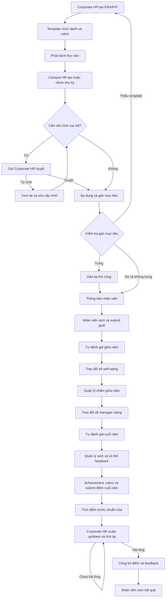

# 00 — Tổng quan và cách đọc BPMN

## 1. Phạm vi nguồn

**[BPMN]** File có một pool `OVERALL RATING PROCESS OF PMS`, một process `Process_1`, bốn lane, 57 task, 25 exclusive gateway, 96 sequence flow, một start event, một end event, hai data store reference và 16 text annotation.

Process có `isExecutable="false"`. Toàn bộ 57 hoạt động được khai báo là `task` tổng quát; một số được chú thích `Service / Automation Task`, nhưng không được khai báo XML thành `serviceTask`. Không có `conditionExpression`, đường `default`, timer event, message flow, subprocess hay parallel gateway. Đây là sơ đồ nghiệp vụ để phân tích, chưa phải workflow có thể nạp vào engine rồi thực thi ngay.

**[Đề xuất]** Tài liệu tách các năng lực thành module, không ánh xạ mỗi lane thành một ứng dụng riêng. Một chức năng có thể được nhiều vai trò sử dụng ở các bước khác nhau.

## 2. Thuật ngữ

| Thuật ngữ | Nghĩa dùng trong tài liệu |
|---|---|
| Corporate HR / HRBP | Nhân sự cấp công ty; quản lý thư viện, duyệt thay đổi, chuẩn hóa và công bố |
| Campus HR / HRBP | Nhân sự tại cơ sở; tổ chức chu kỳ và phân bổ mục tiêu |
| L1 Manager | Quản lý cấp trực tiếp của nhân viên |
| Employee | Nhân viên được đánh giá |
| Designation | Chức danh dùng ánh xạ template; không đồng nhất với vai trò phân quyền |
| KRA | Key Result Area — nhóm lĩnh vực kết quả cần đánh giá |
| KPI | Key Performance Indicator — tiêu chí/chỉ số thuộc KRA |
| Rubric | Thang điểm và mô tả mức đạt của một KPI |
| Template library | Bộ mẫu mục tiêu theo chức danh, sử dụng KRA/KPI và rubric |
| Appraisal cycle | Chu kỳ đánh giá được Campus HR tạo hoặc clone |
| Goal | Mục tiêu cụ thể được gán cho nhân viên từ template |
| Self-rating / Manager rating | Đánh giá của nhân viên / đánh giá của quản lý, cần lưu phân biệt |
| Achievement | Giá trị hoặc kết quả thực tế hỗ trợ chấm điểm |
| Pre-normalization score | Điểm tính trước khi Corporate HR chuẩn hóa |
| Normalization | Điều chỉnh điểm bằng nhánh scale up/down và tính lại trong sơ đồ |

Các diễn giải thuật ngữ là cách đọc phục vụ thiết kế. BPMN không cung cấp từ điển dữ liệu hay đầy đủ cấu trúc của từng khái niệm.

## 3. Luồng toàn trình

Sơ đồ trên rút gọn các gateway gộp và task thông báo để dễ đọc. Đường từ thiếu template về thư viện thực tế đi qua thông báo Corporate HR; xem M05. Luồng từ chối cấu hình quay lại bước xem thư viện, không quay lại task tạo chu kỳ.

## 4. Các điểm bàn giao giữa module

| Từ → Đến | Đầu ra cần có — đề xuất triển khai |
|---|---|
| M01 → các module | Danh tính, campus, chức danh và quan hệ quản lý có hiệu lực |
| M02 → M03 | Bộ KRA/KPI Active để xây template |
| M03 → M04 | Phiên bản thư viện đã phát hành |
| M04 → M05 | Chu kỳ và cấu hình được phép áp dụng |
| M05 → M06 | Bộ mục tiêu đã gán và nhân viên đã submit |
| M06 → M07 | Kết quả giữa năm và các trao đổi đã kết thúc theo nhánh lựa chọn |
| M07 → M08 | Điểm quản lý cuối năm và achievement làm căn cứ |
| M08 → M09 | Snapshot điểm trước chuẩn hóa đủ điều kiện xem xét |
| M09 → Employee | Phiên bản kết quả chính thức đã công bố |
| Các module → M10 | Sự kiện nghiệp vụ để tạo thông báo và ghi lịch sử |

## 5. Cách diễn giải khi chuẩn bị FE/BE

- **[BPMN]** Các hoạt động nối tiếp nhau trên một luồng. Sơ đồ không chỉ ra cách tạo instance cho nhiều nhân viên/campus hoặc cách chờ toàn bộ quản lý submit.
- **[Đề xuất]** Có cấu hình cấp chu kỳ/campus và hồ sơ đánh giá riêng theo nhân viên. Không để một nhân viên thao tác làm thay đổi trạng thái của cả chu kỳ.
- **[Cần chốt]** Giữa năm và cuối năm có thời điểm mở riêng không? Sơ đồ đi thẳng từ kết thúc trao đổi giữa năm sang self-rating cuối năm, không có timer chờ.
- **[Đề xuất]** Ưu tiên một ứng dụng với các module nghiệp vụ rõ ràng, chung dữ liệu định danh và chính sách phân quyền. Chỉ quyết định kiến trúc triển khai sau khi chốt phạm vi.

## 6. Những gì không được nguồn mô tả

Đăng nhập/SSO, import nhân sự, quản lý người thay thế, nhắc hạn, tài liệu minh chứng, chữ ký điện tử, khiếu nại sau công bố, báo cáo tổng hợp, lương thưởng và kết nối HRIS chưa có quy trình riêng trong BPMN. Chỉ bổ sung khi có yêu cầu; không coi là chức năng bắt buộc vì tên gọi PMS.
