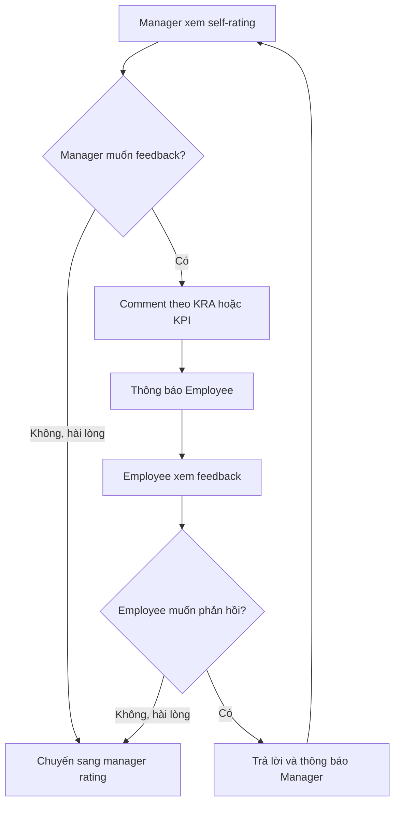

# M06 — Đánh giá giữa năm (Mid-Year Review)

## 1. Phạm vi

**[BPMN]** Annotation `Mid-Year Review` gắn vào task nhân viên tự đánh giá `Activity_1ph24ox` và quản lý chấm goal `Activity_16p384u`. Có hai vòng trao đổi riêng: về self-rating trước khi quản lý chấm, và về manager rating sau khi quản lý submit.

## 2. Giai đoạn A — Nhân viên tự đánh giá

Sau submit goal, Employee thực hiện self-rating (`Activity_1ph24ox`) → submit (`Activity_1uie3ec`) → tự động thông báo Manager (`Activity_1rtms55`) → Manager xem self-rating (`Activity_11j692f`).

**[Cần chốt]** Nhân viên chấm từng KPI hay có cả tổng điểm? Có bắt buộc achievement/minh chứng không? Sơ đồ chỉ nêu tự đánh giá và các comment trên KRA/KPI, không có cấu trúc form.

**[Đề xuất]** Lưu nháp đánh giá theo KPI, phân biệt draft và submitted revision; chỉ manager được phân công mới xem bản đã submit. Điểm tự đánh giá và điểm quản lý là hai tập dữ liệu độc lập.

## 3. Giai đoạn B — Trao đổi về self-rating

ID quyết định: `Gateway_0krqumi` của Manager, `Gateway_04zimsb` của Employee; nhánh trả lời quay về `Gateway_0c6iud2`. Nhánh không phản hồi của một bên hợp tại `Gateway_1s5hl5u` rồi đi chấm quản lý.

**[BPMN]** Không có đường yêu cầu sửa điểm rồi submit self-rating lại. Trao đổi là comment/respond; không tự suy ra quyền thay đổi bản đánh giá đã submit.

**[Cần chốt]** Nhãn loop nói “until both parties are satisfied”, nhưng cấu trúc thực tế cho đi tiếp ngay khi bên đang quyết định chọn No. Không có hai task xác nhận độc lập của cả hai bên. Cần chọn một trong hai chính sách trước triển khai: kết thúc theo nhánh hiện có, hoặc bắt cả hai xác nhận bằng trạng thái riêng.

## 4. Giai đoạn C — Manager rating giữa năm

Manager chấm goal (`Activity_16p384u`) → submit (`Activity_0ygdxgj`) → thông báo Employee (`Activity_1arvgb4`) → Employee xem manager rating (`Activity_0o834q6`).

Trong nhánh giữa năm không có task `Input Achievement`, `Calculate Score pre Normalization` hay chuẩn hóa riêng. **[Cần chốt]** Có tính tổng điểm giữa năm không và có góp vào điểm cuối năm không? Không áp dụng mặc định cùng công thức cuối năm.

## 5. Giai đoạn D — Trao đổi về manager rating

1. Employee quyết định tại `Gateway_1fg1yqp`.
2. No (Employee Satisfied): đi sang self-rating cuối năm.
3. Yes: comment từng KRA/KPI của manager rating (`Activity_19hm5an`) → thông báo Manager (`Activity_0zactp8`).
4. Manager xem feedback (`Activity_11ejbvg`) và quyết định tại `Gateway_1v42x5g`.
5. No (Manager Satisfied): đi sang self-rating cuối năm.
6. Yes: trả lời (`Activity_0sk989p`) → thông báo Employee (`Activity_1sgv8ot`) → Employee xem manager rating và lặp.

Vòng này quay lại **xem** manager rating, không quay lại task **chấm**. Việc sửa điểm sau tranh luận chưa được mô tả. Không có khiếu nại/escalation cấp HR hoặc giới hạn số vòng.

## 6. Dữ liệu, trạng thái và quy tắc đề xuất

- `ReviewRound(kind=MID_YEAR)` gắn với một bộ goal và người quản lý của hồ sơ.
- `SelfAssessment` và `ManagerAssessment`, mỗi bên có điểm theo item, comment, revision và thời điểm submit.
- `FeedbackThread(context=SELF_RATING|MANAGER_RATING)` và message gắn vào KRA/KPI, tác giả, thời điểm; tách hai context để không lẫn nội dung.
- Trạng thái gợi ý: `SELF_DRAFT → SELF_SUBMITTED → SELF_DISCUSSION → MANAGER_DRAFT → MANAGER_SUBMITTED → RATING_DISCUSSION → COMPLETED`. Các bước discussion có thể kết thúc ngay bằng nhánh No.
- Submit phải kiểm tra dữ liệu bắt buộc và phiên bản; thay đổi trạng thái cùng lưu snapshot trong một transaction.
- Chưa có hạn hoặc nút kết thúc thì cuộc trao đổi có thể kéo dài vô hạn; reminder/deadline chỉ bổ sung sau khi chốt.

## 7. Gợi ý FE/BE và nghiệm thu

FE: form self-rating, màn hình quản lý so sánh goal/rubric/self-rating, form manager rating, thread theo tiêu chí, nút “Phản hồi” và “Kết thúc trao đổi” có ý nghĩa rõ ràng. Không suy diễn sự im lặng là nhánh No.

BE: lệnh lưu nháp/submit riêng cho Employee và Manager, mở/đóng thread, kiểm tra tác giả và trạng thái, phát sự kiện thông báo. Nhóm API: `review-rounds`, `self-assessments`, `manager-assessments`, `feedback-threads`.

Nghiệm thu đề xuất: đi qua được cả đường không trao đổi và đường lặp nhiều lượt ở từng vòng; feedback đúng context/KPI; chưa submit self-rating thì manager không submit điểm; Employee không sửa manager rating; kết thúc giữa năm không tự công bố điểm cuối năm.
