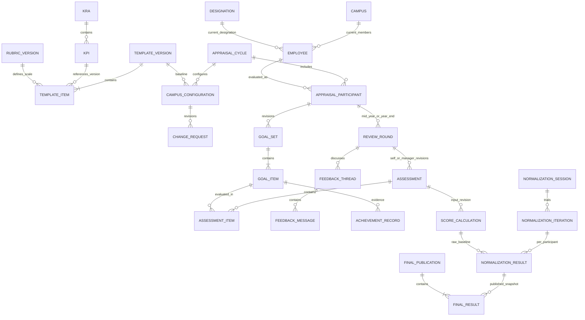

# 11 — Mô hình dữ liệu nghiệp vụ đề xuất

## 1. Nguyên tắc

Toàn bộ entity và trường trong tài liệu này là **[Đề xuất]**, suy ra từ các đối tượng nghiệp vụ của BPMN. File nguồn chỉ có hai data store reference cho KRA/KPI Active và Global Rubric; không chứa schema cơ sở dữ liệu.

Ưu tiên giữ rõ ba lớp: cấu hình dùng lại, bản cấu hình được chốt cho chu kỳ, dữ liệu đánh giá/kết quả của từng người. Dữ liệu đang chạy không phụ thuộc vào nội dung có thể bị sửa của thư viện hiện tại.

## 2. Quan hệ chính

Sơ đồ rút gọn, chưa phải ERD vật lý hoàn chỉnh: mapping template–designation, role assignment, rubric level, assignment run, formula version, notification và audit được mô tả ở bảng dưới. Quan hệ KRA–KPI một-nhiều là giả định cần chốt. `CampusConfiguration` cần chứa nhiều template nếu một chu kỳ dùng cả thư viện; quan hệ từ `TEMPLATE_VERSION` nên triển khai qua bảng item/mapping, không ép chỉ có một template cho cả campus.

## 3. Entity và trường tối thiểu gợi ý

| Nhóm | Entity | Thuộc tính/quan hệ cốt lõi |
|---|---|---|
| M01 | Employee, Campus, Designation | Mã định danh, tên, trạng thái; thông tin hiện hành |
| M01 | RoleAssignment | User, role, scope; tách khỏi designation |
| M01 | ManagerAssignment | Employee, manager, effectiveFrom/effectiveTo |
| M02 | KRA, KPI, KpiVersion | Mã, trạng thái, nội dung và version; KPI tham chiếu KRA |
| M03 | LibraryVersion, TemplateVersion | Thư viện, số version, trạng thái, nội dung, người/thời điểm phát hành |
| M03 | TemplateDesignation | Template version, designation và điều kiện áp dụng nếu có |
| M03 | TemplateItem | KPI version, KRA tham chiếu, rubric version, thứ tự; target/weight nếu được chốt |
| M03 | RubricVersion, RubricLevel | Nguồn global/custom, mức điểm và mô tả; kiểu biên nếu dùng khoảng số |
| M04 | AppraisalCycle | Mã, tên, phạm vi, thời gian, thư viện nguồn, trạng thái cấp chu kỳ |
| M04 | CampusConfiguration | Cycle, campus, revision, baseline, các template/rubric local đã chốt |
| M04 | ChangeRequest | Configuration revision, người gửi/duyệt, trạng thái, lý do, thời gian |
| M05 | AppraisalParticipant | Cycle, employee, campus/designation/manager snapshot, điều kiện tham gia |
| M05 | AssignmentRun, AssignmentIssue | Cấu hình đầu vào, trạng thái, thống kê, participant và lỗi thiếu/trùng |
| M05 | GoalSet, GoalItem | Participant, template/configuration revision, item snapshot, trạng thái submit |
| M06/07 | ReviewRound | Participant, kind MID_YEAR/YEAR_END, goal revision và trạng thái |
| M06/07 | Assessment, AssessmentItem | Round, loại SELF/MANAGER, revision, draft/submitted, điểm/comment theo goal |
| M06/07 | FeedbackThread, FeedbackMessage | Round, context, KRA/KPI/item, người gửi, nội dung, thời gian, trạng thái thread |
| M08 | AchievementRecord | Round và goal item, giá trị, đơn vị, nguồn, external reference, revision |
| M08 | FormulaVersion, ScoreCalculation | Chính sách tính, submission revision, input snapshot, điểm gốc, trạng thái tính |
| M09 | NormalizationSession | Chu kỳ, phạm vi/cohort và tập raw calculation version |
| M09 | NormalizationIteration | Session, iteration number, direction, tham số, baseline, lý do, người tạo |
| M09 | NormalizationResult | Iteration, participant, raw calculation, điểm preview, giải thích |
| M09 | FinalPublication, FinalResult | Bản công bố, participant, kết quả từ iteration, final score, feedback snapshot |
| M10 | OutboxEvent, Notification, Delivery | Event ID, recipient, channel, trạng thái, retry, correlation ID |
| M10 | AuditEvent | Actor, action, target, revision, thời gian và lý do |

## 4. Khóa nghiệp vụ và ràng buộc đề xuất

- `AppraisalParticipant(cycle_id, employee_id)` duy nhất nếu một người chỉ có một hồ sơ/chu kỳ. Nếu chu kỳ có nhiều campus dùng mã khác nhau, cần định nghĩa `cycle_id` rõ trước.
- `ReviewRound(participant_id, kind)` duy nhất nếu chỉ có hai kỳ chuẩn. Nếu có nhiều round cùng loại, thêm sequence/version và quy tắc hiệu lực.
- `Assessment(round_id, type, revision)` duy nhất; chỉ một draft/current submitted revision hiệu lực theo chính sách.
- `AssessmentItem(assessment_id, goal_item_id)` duy nhất; kiểm tra goal thuộc đúng participant và vòng.
- Một GoalSet hiệu lực/participant; lưu lịch sử revision. Không cấm một GoalSet có nhiều KPI.
- `NormalizationResult(iteration_id, participant_id)` duy nhất; không gộp điểm nhiều người vào một giá trị chung.
- Một kết quả chính thức hiệu lực/participant theo phạm vi công bố đã chốt; bản cũ giữ lịch sử khi có quy trình công bố lại.
- `Notification(event_id, recipient_id, channel)` duy nhất để xử lý event lặp.

## 5. Snapshot và version

Lúc phân bổ goal, chốt phiên bản template, KPI, rubric và nội dung cần hiển thị. Lúc submit, chốt rating revision. Lúc tính điểm, chốt input/formula version. Lúc chuẩn hóa, chốt raw baseline và tham số. Lúc publish, chốt final score và feedback.

Có thể tham chiếu bảng version bất biến hoặc lưu snapshot; chọn một chiến lược nhất quán. Không chỉ lưu ID của bản ghi danh mục được phép sửa trực tiếp rồi đọc nội dung hiện hành cho hồ sơ cũ.

## 6. Transaction và công việc nền đề xuất

| Hành động | Phần cần nhất quán | Có thể chạy nền |
|---|---|---|
| Phát hành thư viện | Kiểm tra nội dung + chốt version Published | Báo cho người dùng nếu có |
| Duyệt cấu hình | Kiểm tra revision + lưu quyết định duy nhất | Gửi thông báo |
| Gán goal | Ghi bộ goal mỗi participant + chống trùng | Chạy batch, tổng hợp coverage |
| Submit rating | Chốt assessment revision + đổi trạng thái + outbox | Notify, tính điểm |
| Tính điểm | Lưu calculation theo input/version | Retry khi lỗi |
| Công bố | Chốt tập FinalResult và trạng thái công bố | Notify sau commit |

Không cần một transaction dài bao trùm toàn bộ chu kỳ. Nếu gán/công bố theo batch, phải có trạng thái tiến độ và tiêu chí hoàn tất, tránh trả thành công khi còn lỗi chưa xử lý.

## 7. Chưa quyết định

Chưa chốt DBMS, ORM, UUID hay số tăng, soft delete, cơ chế lưu file, kiểu API hay framework. Các quyết định đó đến sau khi thống nhất cardinality, công thức, quyền và vòng đời dữ liệu.
